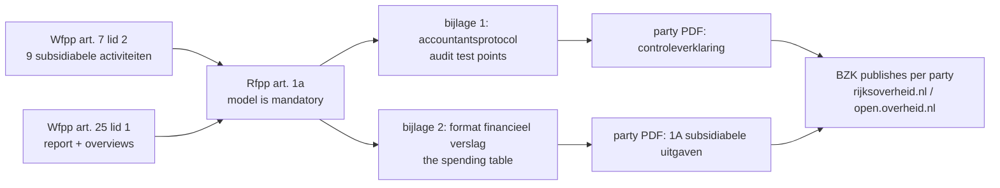

# LANE — the subsidieverantwoording: what the BZK model fixes, and what it does not

Read-only research lane. Question: is there a standardised Dutch expenditure document for party
subsidies, what does it mandate, where is it published, are parties' documents available — and can a
comparable spending series be built from it.

**Verdict in one line:** the model exists and is binding since 1 April 2025, but it standardises the
*columns and the totals*, not the *categories*. Six parties, six row taxonomies, first year of
application. A category series is not buildable from this document class; a party-level series of
three totals is, with per-party extraction and human verification.

---

## 1. The document, and where it sits in the chain

There is no separate "subsidieverantwoording" document next to the annual report, which is how
`docs/FINDING-004-spending-is-not-comparable.md` framed it. The spending statement is the Wfpp
financieel verslag itself, filed in the mandated format: the **model in bijlage 2 of the Regeling
financiering politieke partijen (Rfpp)**, which every party in receipt of subsidy must use as its
reporting form:

> "De politieke partij gebruikt bij het opstellen van het verslag het model opgenomen in bijlage 2 bij
> deze regeling."
> — [Rfpp art. 1a lid 1, geldend 01-04-2025](https://wetten.overheid.nl/BWBR0033335/2025-04-01)

The form covers two parts: **A** — subsidiabele uitgaven, ontvangen giften en bijdragen, overzicht
schulden, activiteitenverslag; **B** — vermogenspositie and ledenaantallen
([Rfpp bijlage 2](https://wetten.overheid.nl/BWBR0033335/2025-04-01); protocol §1.1, p. 3 of
[COPRO 24025](https://www.nba.nl/siteassets/wet--en-regelgeving/controleprotocollen/ministeries/bzk/accountantsprotocol-rfpp-2024.pdf)).
The spending table is section **1A** of part A.

Applicability: "Dit protocol heeft een ingangsdatum van boekjaren eindigend op 31 december 2024 of
later" ([Rfpp bijlage 1, §1.1](https://wetten.overheid.nl/BWBR0033335/2025-04-01)); the nota van
toelichting says the same — "vanaf de financiële verantwoording over 2024"
([Stcrt. 2025, 6489](https://zoek.officielebekendmakingen.nl/stcrt-2025-6489.pdf), p. 1).
So 2023 filings are pre-model; 2024 filings are the first under it.

## 2. (a) What the model actually mandates

The 1A skeleton, printed in the regeling, is:

| row as printed (Rfpp bijlage 2, §1A) |
|---|
| *Overzicht uitgaven en toegekende subsidie Financiering Politieke Partijen (voorbeeld)* — columns 2024, 2023 |
| Bestuurskosten |
| Bureaukosten |
| Verkiezingskosten |
| Etc. |
| Totaal subsidiabele uitgaven |
| Toegekende subsidie WFPP |
| Verschil |

What is binding, from the "Grondslagen" under the table
([Rfpp bijlage 2](https://wetten.overheid.nl/BWBR0033335/2025-04-01)):

1. **A table with total amounts per cost category ("per kostencategorie"), plus comparative figures
   for the prior year, plus a total of subsidiary spend.**
2. **The granted subsidy for the year** — "Onder de toegekende subsidie dient het beschikte
   subsidiebedrag over het desbetreffende jaar te worden opgenomen." (The *beschikking*, not the cash
   received.)
3. **A statement that the spend concerns the art. 7 Wfpp activities.**
4. **Five exclusions, closed list:** spend already financed by government or third parties;
   commercial/marketing spend of a non-political character; fines and administrative sanctions;
   provisions for future losses and debts; reservations.
5. **The grondslagen block itself**, which parties copy verbatim.

What is **not** binding is the category vocabulary. The row list is headed "(voorbeeld)" and the only
instruction on it reads:

> "Uitgaven moeten zo specifiek mogelijk worden opgenomen in de verantwoording, waarbij onderscheid
> wordt gemaakt tussen verschillende kostensoorten, zoals bijvoorbeeld bestuurskosten, bureaukosten,
> verkiezingskosten, personeelskosten, huisvestingskosten, en overige kosten."
> — [Rfpp bijlage 2](https://wetten.overheid.nl/BWBR0033335/2025-04-01)

"zoals bijvoorbeeld" — exemplary, open. There is no minimum row count, no defined row names, no rule
on whether rows are cost types or activities, and no rule on the unit of observation (party alone, or
party plus its neveninstellingen, which the protocol says may file through the party as a
"doorgeefluik", [protocol §1.1](https://www.nba.nl/siteassets/wet--en-regelgeving/controleprotocollen/ministeries/bzk/accountantsprotocol-rfpp-2024.pdf)).

The only closed vocabularies anywhere in the regime are:
- the **nine activity categories** of
  [Wfpp art. 7 lid 2 a–i](https://wetten.overheid.nl/BWBR0033004/2026-06-06) — the *audit test* for
  whether spend is subsidiable ("De accountant controleert de rechtmatigheid van de uitgaven … Deze
  uitgaven moeten direct samenhangen met de volgende activiteiten", protocol §3.1.1(a)); and
- the **five exclusions** above.

Neither is a reporting taxonomy. The protocol is explicit that its test points are the limit of what
the accountant examines — "andere toetspunten zijn er niet voor de accountant" (protocol §2.2) — not a
chart of accounts.

The ministry's own summary of what the formats uniformise does not include expenditure categories:

> "Deze formats zien op de overzichten van de onderstaande aspecten … Ontvangen bijdragen (inclusief
> bijdragen in natura); Schulden; Activiteitenverslag en verloop ledenaantal; Vermogenspositie."
> — [Stcrt. 2025, 6489, p. 18](https://zoek.officielebekendmakingen.nl/stcrt-2025-6489.pdf)

## 3. (b) Where the model and the protocol are published

| Document | Where | Version / date |
|---|---|---|
| Rfpp, incl. bijlage 1 (accountantsprotocol) and bijlage 2 (format financieel verslag) | [wetten.overheid.nl/BWBR0033335/2025-04-01](https://wetten.overheid.nl/BWBR0033335/2025-04-01) | geldend 01-04-2025 |
| Amendment introducing art. 1a and both bijlagen | [Stcrt. 2025, 6489](https://zoek.officielebekendmakingen.nl/stcrt-2025-6489.html) ([PDF](https://zoek.officielebekendmakingen.nl/stcrt-2025-6489.pdf)) | regeling 18-03-2025, nr. 2025-000043400, published 21-03-2025, in force 01-04-2025 |
| Accountantsprotocol Wfpp (COPRO 24025) | [NBA PDF](https://www.nba.nl/siteassets/wet--en-regelgeving/controleprotocollen/ministeries/bzk/accountantsprotocol-rfpp-2024.pdf); NBA landing page [Wfpp controleprotocollen](https://www.nba.nl/wet--en-regelgeving/controleprotocollen/ministeries/binnenlandse-zaken-en-koninkrijksrelaties/wfpp/) | "Versie: 18 maart 2025", header COPRO 24025 |
| Kamerbrief announcing protocol + regeling change | [rijksoverheid.nl, 19-03-2025](https://www.rijksoverheid.nl/documenten/2025/03/19/kamerbrief-over-accountantsprotocol-wet-financiering-politieke-partijen) | Kamerstuk 19-03-2025 |
| Publication page for the regeling change | [rijksoverheid.nl, 19-03-2025](https://www.rijksoverheid.nl/documenten/2025/03/19/wijziging-regeling-financiering-politieke-partijen-accountantsprotocol) | — |
| Beslisnota (Woo-bijlage) | [rijksoverheid.nl, 29-01-2025](https://www.rijksoverheid.nl/documenten/2025/01/29/beslisnota-bij-kamerbrief-over-accountantsprotocol-wet-financiering-politieke-partijen) | — |
| Filed reports, 2023 | [deel 1](https://www.rijksoverheid.nl/documenten/2024/10/22/financiele-verslagen-politieke-partijen-over-2023-deel-1) · [deel 2](https://www.rijksoverheid.nl/documenten/2024/10/22/financiele-verslagen-politieke-partijen-over-2023-deel-2) | published 22-10-2024, 20 documents |
| Filed reports, 2024 | [financiele-verslagen-over-2024](https://www.rijksoverheid.nl/documenten/2025/10/22/financiele-verslagen-over-2024-van-politieke-partijen) (hub: [overzichten 2024](https://www.rijksoverheid.nl/documenten/2025/10/22/overzichten-financiering-politieke-partijen-2024)) | published 22-10-2025, 19 documents |
| Machine-readable document index | [partijfinanciering.nl dashboard](https://www.partijfinanciering.nl/dashboard/jaarlijkse-verantwoording/financiele-verslagen); GraphQL `jaarverslagen` at [api.partijfinanciering.nl/v1/graphql](https://api.partijfinanciering.nl/v1/graphql) | fields: `partij, jaar, link, pages, bestand_grootte_mb, datum` — **links only, no amounts** |

Two publication-shape changes matter for reuse. 2023 files sit at stable `site-content` paths with the
party in the filename (`…/4+VVD.pdf`). 2024 files are `open.overheid.nl` UUID links with no filename
(`…/29d470ee-6f85-4cca-b024-03149374528f/file`). The dashboard's own index is the only place the two
are reconciled per party and year; it carries no filenames and no figures.

## 4. (c) Party documents, 2023 and 2024, with the shape each one actually uses

All URLs below were fetched (HTTP 200) and the 1A section read from the PDF text. Sample: six parties
of the nineteen 2024 filers, chosen for spread across size — 65 to 249 pages.

| Party | Year | Document | 1A heading used | Row taxonomy | Total row | Subsidy row | Difference row | 2023 comparative |
|---|---|---|---|---|---|---|---|---|
| CDA | 2024 | [open.overheid.nl/…/6de50790](https://open.overheid.nl/documenten/6de50790-76d7-4bd1-bf91-1513d7d713bd/file) | "1A. Subsidiabele uitgaven en toegekende subsidie" | art. 7 activity letters (a,b,c,f,h,i then d,e) | "Totaal subsidiabele uitgaven" € 4.254.795 | "Toegekende subsidie WFPP" € 1.927.680 | "Verschil" € 2.327.115 | yes |
| D66 | 2024 | [open.overheid.nl/…/94eb3c7f](https://open.overheid.nl/documenten/94eb3c7f-f9d5-44b8-933f-9f5758f8ffbf/file) | "Subsidiabele uitgaven en toegekende subsidie - D66" | cost types (Personeel, Huisvesting, …) **then** activity letters A–I | "Totaal" € 3.758.623 | "Toegekende subsidie" € 1.739.659 | "Verschil" € 2.018.964 | yes |
| VVD | 2024 | [open.overheid.nl/…/29d470ee](https://open.overheid.nl/documenten/29d470ee-6f85-4cca-b024-03149374528f/file) | "Overzicht kosten Financiering Politieke Partijen 2024" | 3 activity groups, 16 cost lines inside | "Totaal subsidiabele kosten" € 3.295.571 | none | none | yes |
| GroenLinks | 2024 | [open.overheid.nl/…/ebdaabae](https://open.overheid.nl/documenten/ebdaabae-2c63-4a39-8ff0-7001ed5c0f81/file) | "1A. Overzicht uitgaven en toegekende subsidie Financiering Politieke Partijen" | activity letters with cost-type rows interleaved (three rows prefixed "I.") | "Totaal" € 2.477.845 | "Ontvangen WFPP subsidie" € 1.353.487 (+ € 170.452 prior-year tranche, separate line) | none | yes |
| SP | 2024 | [open.overheid.nl/…/f6c6efac](https://open.overheid.nl/documenten/f6c6efac-2598-454d-ab36-8a2ae0dd9af7/file) | none — "bestedingsverslag" + "Recapitulatie werkelijk 2024" | 4 activity groups, each a kostenverdeelstaat (direct/indirect) | "Totalen" € 1.812.737 | "Maximaal subsidiebudget" € 1.621.623 | none | no |
| PvdD | 2024 | [open.overheid.nl/…/105e3a54](https://open.overheid.nl/documenten/105e3a54-471d-46b1-8e25-8e260878f153/file) | "Overzicht subsidiabele uitgaven 2024" (in Overige gegevens) | 3 activity rows × Personeel / Organisatie / Directe kosten | "Totaal" € 1.667.563 | none | none | no |

2023 documents, pre-model, same parties:

- VVD — <https://www.rijksoverheid.nl/site/binaries/site-content/collections/documents/2024/10/22/financiele-verslagen-politieke-partijen-over-2023-deel-1/4+VVD.pdf>
- CDA — <https://www.rijksoverheid.nl/site/binaries/site-content/collections/documents/2024/10/22/financiele-verslagen-politieke-partijen-over-2023-deel-1/10+CDA.pdf>
- D66 — <https://www.rijksoverheid.nl/site/binaries/site-content/collections/documents/2024/10/22/financiele-verslagen-politieke-partijen-over-2023-deel-1/8+D66.pdf>
- GroenLinks — <https://www.rijksoverheid.nl/site/binaries/site-content/collections/documents/2024/10/22/financiele-verslagen-politieke-partijen-over-2023-deel-1/5-GL.pdf>
- SP — <https://www.rijksoverheid.nl/site/binaries/site-content/collections/documents/2024/10/22/financiele-verslagen-politieke-partijen-over-2023-deel-1/11+SP.PDF>
- PvdD — <https://www.rijksoverheid.nl/site/binaries/site-content/collections/documents/2024/10/22/financiele-verslagen-politieke-partijen-over-2023-deel-2/15+PvdD.pdf>

Full 2023 set (20) and 2024 set (19) are enumerable from the publication pages in §3.

## 5. Feasibility verdict

**Can a comparable spending series be built from this document class?**

Split the answer, because the two halves have opposite answers.

### No — not a category series

Six parties, six row taxonomies, in the first year the model binds. The failure is not
non-compliance; CDA's and D66's tables copy the model's grondslagen word for word and then fill the
rows their own way. Four structural reasons, in order of weight:

1. **The taxonomy is open by design.** "zoals bijvoorbeeld" plus "(voorbeeld)" in the skeleton. A
   party that reports 16 cost lines grouped under three activities (VVD) and a party that reports
   eight activity letters (CDA) are both compliant. Nothing in the model makes their rows align.
2. **The model's required row is not reliably present.** The text requires "Onder de toegekende
   subsidie dient het beschikte subsidiebedrag … te worden opgenomen". Two of six sampled parties
   print that figure under the model's label (CDA, D66); GroenLinks prints received subsidy and SP a
   ceiling; VVD and PvdD print no subsidy row at all — and the Teldersstichting's annex for the VVD
   prints the required sentence *directly below a table that has no subsidy row*
   ([VVD 2024](https://open.overheid.nl/documenten/29d470ee-6f85-4cca-b024-03149374528f/file)).
   Boilerplate compliance and tabular compliance diverge.
3. **The subsidy figure is not one concept.** CDA and D66 report the granted amount; GroenLinks
   reports *received* subsidy split into the current year and a prior-year tranche; SP reports
   "maximaal subsidiebudget". A column labelled "subsidie" therefore mixes a beschikking, a cash
   receipt and a ceiling.
4. **The unit of observation varies.** D66 files four entity-level 1A tables (party, Van Miert
   Stichting, IDI, Jonge Democraten); GroenLinks four; PvdD one three-row table under "Overige
   gegevens". Party totals are not additive to a party-group total without knowing which entities
   are inside.

The supervisor says the same thing, after the model took effect:

> "er kan een verschil zijn in de interpretatie van wat subsidiabele uitgaven precies zijn. Dit kan
> leiden tot verschillen in de verantwoordingen. Daarom adviseert de commissie een geactualiseerde
> uitleg over subsidiabele en niet-subsidiabele uitgaven per categorie."
> — [Ctfpp advies verantwoordingsjaar 2024, 23-09-2025, p. 5](https://open.overheid.nl/documenten/0807f9a9-b9aa-43f7-b232-0779216e8a18/file)

### Yes — a three-field party-level series, with per-party verification

Every sampled party prints a total of subsidiary spend (under four different labels — only CDA uses
the model's own "Totaal subsidiabele uitgaven"), and every subsidised party prints some subsidy
figure. A series of

`party × year × {total subsidiabele uitgaven, subsidiebedrag, verschil}`

is defensible **if** each party's label→concept mapping is recorded once (as with the per-party column
templates in FINDING-004) and the entity scope is recorded with it. That is ~19–20 PDFs per year, some
of them 250 pages, several with four entity-level 1A tables (D66, GroenLinks). It gives totals, never
a breakdown.

### Main obstacle

**The model standardises the arithmetic, not the vocabulary.** It fixes columns (current year,
comparative, total), the three totals, and a five-item exclusion list; it leaves the row set to the
party. So the one artefact in the regime that could carry a common expenditure taxonomy is explicitly
not one. Secondary obstacles, both real but smaller: publication is PDF-only (the ministry's own
index is links, no figures), and the reporting entity is not fixed.

### What would change the verdict

- A closed cost-category list in Rfpp bijlage 2 — i.e. BZK adopting the Ctfpp's request. Until then,
  a series by **art. 7 activity letter** is the least-bad target, because that vocabulary *is* closed
  and three of six sampled parties already report at least partly by letter (CDA, D66, GL). It fails
  today only because the other three group activities differently (VVD 3 groups, SP 4, PvdD 3).
- Or a central dataset: the `jaarverslagen` GraphQL table currently stores `link, pages,
  bestand_grootte_mb` and nothing else. A single numeric table there would replace this entire
  extraction.

## 6. Correction to FINDING-004

`docs/FINDING-004-spending-is-not-comparable.md` closes with "Parties in receipt of subsidy file a
model justification with fixed categories. That is the only standardised expenditure document." The
first clause is now falsified by the primary text: the model exists (since 1 April 2025) and its
categories are not fixed. FINDING-004's refusal to publish a campaign-spend series stands; its
proposed route to a comparable series does not.

## 7. Method, receipts, limits

- Fetched over `curl -sSL -A "Mozilla/5.0"` (HTTP 200 unless noted): the Rfpp, the Wfpp, Stcrt.
  2025, 6489, both NBA PDFs, the 19 March 2025 Kamerbrief and wijziging pages, the three BZK
  publication pages, the Ctfpp advice, and all six 2024 party PDFs. Of the 2023 URLs, SP was
  downloaded and VVD was checked by HEAD (301 from the dashboard's `binaries/rijksoverheid/…` form to
  the `site-content` path quoted here); the other four 2023 links are enumerated from the two
  publication pages, not independently re-fetched.
- PDFs were converted with `pdftotext -layout` and the 1A sections read directly; figures in §4 are
  transcribed from those extractions, not computed.
- 2023/2024 counts (20 and 19) come from querying `jaarverslagen` and match the publication pages;
  the 2024 overviews page states "19 politieke partijen hebben een correcte verantwoording
  ingediend".
- Limits: six of nineteen 2024 documents read in full (CDA, D66, VVD, GL, SP, PvdD). The other
  thirteen were not read, so "six shapes in six parties" is a lower bound on the variance, not a
  census. PvdD's document is a scan with heavy OCR noise (`Specificatie subsidiabele kosten` totals
  read as `1.667.563`, adjacent columns as `2.6,068`); its total is quoted as printed and not
  verified against the underlying accounts. No 2025 document is published: the `jaarverslagen` index
  returns zero rows for `jaar >= 2025` and the dashboard's "Laatste update" reads 22 October 2025.
- No repo files other than this report were modified; scratch downloads were removed.
